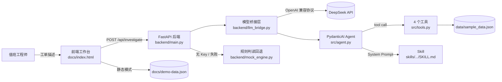

# 项目介绍文档：校园网延迟调查 Agent

> 项目代号：**NOC-01 · Campus Latency Copilot**
> 文档版本：v1.0（MVP 阶段）
> 小组：李开旭（23211239）、詹林（23271081）　编写：詹林　审阅：李开旭
> 对应代码：`src/`（CLI Agent）、`backend/`（Web 后端）、`docs/index.html`（前端）
> 关联文档：[02-前端界面设计文档](./02-前端界面设计文档.md) ・ [03-后端HLD.md](./03-后端HLD.md)

---

## 1. 项目背景

校园网值班工程师每天都会收到这样的工单：

> "从汇聚路由器 A 到接入交换机 1 号（`link-dist-a-sw1`）的路径特别慢，网页打不开，视频一直转圈。"

这类问题的难点不在于"看不见指标"，而在于**指标太多、判断太依赖经验**：

- 同一条"变慢"的工单，可能是**排队拥塞**、**路由变更走了备用链路**、**光模块硬件故障**，也可能只是**监控数据缺失**；
- 利用率、RTT、丢包率、队列深度、到达率分散在不同系统里，需要人工交叉比对；
- 新工程师容易"看到丢包就换模块""看到延迟就加带宽"，缺少可复用的推理路径；
- 人工排查耗时，且结论往往没有留下证据链，事后无法复盘。

因此本项目把"延迟归因"这一高频、可结构化、又有明确网络理论支撑的任务，做成一个**能自己取证、自己算、自己下结论的 AI Agent**。

---

## 2. 目标用户与使用场景

| 维度 | 说明 |
| --- | --- |
| 主要用户 | 校园网 NOC（网络运行中心）一线值班工程师 |
| 次要用户 | 网络专业学生 / 助教，用于演示"Agent + Tool + Skill"如何落地 |
| 使用环境 | 值班台 PC 浏览器；或本地终端（CLI 模式） |
| 触发方式 | 收到一条延迟类工单 → 打开工作台 → 选择/输入工单 → 点击「开始调查」 |
| 期望输出 | 一份含**问题概述、证据、反证、结论、置信度、处置建议**的中文调查报告，并保留完整工具调用轨迹 |

**典型使用场景**

1. **工单初筛**：工程师把工单原文粘进输入框，Agent 自动完成链路体检并给出初步归因。
2. **交接班复盘**：打开历史 trace，逐条查看 Agent 调了哪些工具、拿到了什么数据、为什么这样判断。
3. **教学对照**：关闭 Skill 开关，让学生直观看到"有领域知识"和"没有领域知识"时同一模型的判断差异。

---

## 3. 项目目标

### 3.1 业务目标

- 把一次延迟类工单的**首轮归因时间**从人工十几分钟压缩到一次对话；
- 让结论**可追溯**：每个判断都能指回具体工具返回值；
- 把资深工程师的判断经验固化成**可版本管理的 Skill 文件**，而不是留在个人脑子里。

### 3.2 技术目标

- 用 **Agent** 自主决定工具调用顺序，而不是把流程写死；
- 用 **Tool** 承担所有确定性计算（排队论、时延分解），模型只负责"选择与解释"；
- 用 **Skill** 提供领域判读规则（什么组合意味着拥塞、什么组合意味着硬件故障、数据缺失时如何谨慎结论）；
- 同一个 Agent 同时支持 **本地 CLI（Ollama）** 与 **Web（DeepSeek）** 两种入口，保证两条链路行为一致、可对照。

### 3.3 非目标（本阶段明确不做）

- 不接入真实网络设备（数据来自可复现的模拟数据集）；
- 不做多轮长期记忆、不做自动变更执行（只给建议，不动配置）；
- 不做用户体系与权限（课堂级 MVP）。

---

## 4. 系统能力概览

### 4.1 用户可见功能

| 编号 | 功能 | 说明 |
| --- | --- | --- |
| F1 | 自然语言工单输入 | 支持自由描述，也支持从 5 个预置案例一键载入 |
| F2 | 场景切换 | `normal` / `congestion` / `route_change` / `packet_loss` / `incomplete_data` |
| F3 | 自主工具取证 | Agent 自行决定查哪条链路、是否重算、是否分解时延 |
| F4 | 排队论计算 | M/M/1 模型给出 ρ、Lq、Wq；ρ ≥ 1 时明确拒绝给数值 |
| F5 | 时延分解 | 传播 / 传输 / 排队 / 处理四分量 + 理论 RTT 与实测 RTT 对比 |
| F6 | 结构化报告 | 问题概述、证据分析、结论与建议，含置信度与不确定性说明 |
| F7 | 过程可视化 | 前端三个视图：调查报告 / 工具轨迹 / 证据表 |
| F8 | Skill 开关 | 关闭后即为对照组 B，用于课堂演示与实验 |
| F9 | 工具预算控制 | 1–8 轮可调，默认 5 轮硬上限，防止小模型死循环 |
| F10 | 无后端静态演示 | GitHub Pages 上回放真实 trace，页面明确标注"非实时生成" |

### 4.2 三条能力支柱

```text
Agent  —— 负责"做什么"：理解工单、选择工具、组织证据、写出结论
Tool   —— 负责"算什么"：只做确定性计算与数据读取，不猜测
Skill  —— 负责"怎么判断"：领域规则、判读表、常见误判，注入 System Prompt
```

三者的边界是本项目的核心设计约束：

- 数值一律来自 Tool，**不允许模型自己心算**；
- 判断规则来自 Skill，**不允许散落在 Prompt 里靠临场发挥**；
- 流程推进由 Agent 决定，**但预算由代码硬性兜底**。

---

## 5. 功能需求

| ID | 需求 | 验收方式 |
| --- | --- | --- |
| FR-01 | 接收 ≥ 4 个字符的工单描述并返回调查报告 | 空输入前端拦截；API 返回 422 |
| FR-02 | 能列出拓扑中的全部链路 | `list_network` 返回 6 条链路 |
| FR-03 | 能按链路查询利用率、RTT、丢包率、队列深度、到达率 | `get_link_metrics` 字段齐全 |
| FR-04 | 能计算 M/M/1 指标并识别不稳定系统 | ρ ≥ 1 时返回 `is_stable=false` 且无数值 |
| FR-05 | 能分解四类时延并与实测 RTT 比对 | `analyze_delay_components` 返回四分量与比值 |
| FR-06 | 模型调用工具轮数不超过预算 | 模型桥接层强制撤掉 tool schema |
| FR-07 | 报告必须区分"支持证据"与"反驳证据" | 报告模板固定五段 |
| FR-08 | 无 API Key 时仍能给出可用结果并明确标注来源 | `source="mock"` + warning |
| FR-09 | 云端调用失败时自动降级且不白屏 | 捕获异常 → 规则判读 |
| FR-10 | Web 与 CLI 使用同一套工具与 System Prompt | 共用 `register_tools()` / `build_system_prompt()` |

---

## 6. 非功能需求

| 类别 | 要求 |
| --- | --- |
| 可复现性 | 数据、案例、评测脚本、trace 全部入库；一条命令可重跑实验 |
| 可解释性 | 每条结论必须能落到 trace 中的具体工具返回 |
| 诚实性 | 无数据就说无数据；降级/回放模式必须在 UI 上明确标注，禁止伪装成实时结果 |
| 稳定性 | 单次调查必须有硬终止条件（工具预算），不能无限循环 |
| 性能 | 本地 Web 联调单次调查在可接受交互时间内完成；前端首屏无构建、无打包依赖 |
| 可移植性 | 前端为零构建静态文件，可直接部署到 GitHub Pages |
| 安全性 | 不提交任何 API Key；页面内临时 Key 只发往本机后端，不落盘、不写日志 |
| 可访问性 | 语义化标签、键盘可操作、`prefers-reduced-motion` 动效降级 |

---

## 7. 系统总体架构（概览）



详细的模块划分、接口契约与部署方式见 [03-后端HLD.md](./03-后端HLD.md)。

---

## 8. 技术选型与理由

| 层 | 选型 | 理由 |
| --- | --- | --- |
| Agent 框架 | PydanticAI | 工具 schema 由类型注解自动生成；`FunctionModel` 允许把任意模型接入同一 Agent |
| 本地模型 | Ollama + `qwen3.5:0.8b` | CPU 可跑、可离线复现；用于三组对照实验 |
| 云端模型 | DeepSeek（`deepseek-chat`） | 中文报告质量好、价格低、提供 OpenAI 兼容接口 |
| 云端 SDK | `openai`（自定义 `base_url`） | 官方兼容协议，依赖少；避免 LiteLLM 与本地 `mcp` 包的版本冲突（详见 HLD ADR-5） |
| Web 框架 | FastAPI + Uvicorn | 类型校验、自动文档、静态目录挂载，课堂级后端足够 |
| 前端 | 原生 HTML / CSS / JS | 零构建、零依赖，与 GitHub Pages 教程一致，评审可直接读源码 |
| 数据 | 本地 JSON | 无需数据库，便于审阅与复现 |

---

## 9. 数据与知识来源

- **拓扑与指标**：`data/sample_data.json`，7 个节点、6 条链路、5 套场景快照。数据为教学用模拟数据，量级参考真实校园网（核心 10GbE、接入 1GbE）；
- **测试案例**：`tests/cases.json`，覆盖拥塞、路由变更、硬件故障、数据缺失、正常五种情形；
- **领域知识**：`skills/network-latency-investigation/SKILL.md`（调查流程 + 四条硬规则 + 判读表），第三层细节在同目录 `reference.md`（公式推导、量级参考、误判清单）。

---

## 10. 交付物清单

| 类别 | 文件 |
| --- | --- |
| 项目报告 | `report.pdf`（21 页） |
| 设计文档 | `docs/01-项目介绍文档.md`、`docs/02-前端界面设计文档.md`、`docs/03-后端HLD.md` |
| 后端代码 | `backend/{__init__,main,llm_bridge,mock_engine}.py` |
| Agent / Tool / Skill | `src/{agent,tools,skills,models,main}.py`、`skills/**` |
| 前端代码 | `docs/{index.html,style.css,script.js,demo-data.json}` |
| 测试与实验 | `tests/{cases.json,evaluate.py}`、`results/repeat/run4/**` |
| 图表与截图 | `docs/*.png`、`docs/screenshots/**` |
| 运行说明 | `README.md`、`requirements.txt`、`.env.example` |

---

## 11. 里程碑与范围

| 阶段 | 内容 | 状态 |
| --- | --- | --- |
| 第一阶段 MVP | Agent + 4 Tool + Skill + 5 案例 + 三组对照实验 + 报告 | 已完成 |
| 第二阶段（本阶段） | 项目介绍 / 前端设计 / 后端 HLD 三份文档 + 前端工作台 + FastAPI 后端 + 联调 + GitHub Pages | 已完成 |
| 后续可选 | 接入真实设备数据、多轮对话记忆、工单系统对接、自动生成变更单 | 不在本阶段范围 |

---

## 12. 验收标准与关键指标

### 12.1 功能验收

- `python -m backend.main` 自检通过，`/api/health` 返回 `status=ok`；
- 四个接口（`health` / `cases` / `network` / `investigate`）均返回预期结构；
- 前端在**有后端**与**无后端**两种环境下都能完成"选案例 → 开始调查 → 查看报告/trace/证据表"。

### 12.2 实验指标（`qwen3.5:0.8b`，5 案例 × 3 组）

| 指标 | A 直接 LLM | B Agent+Tools | C Agent+Tools+Skill |
| --- | ---: | ---: | ---: |
| 任务成功率 | 1.00 | 1.00 | 0.80 |
| 证据完整度 | 0.450 | 0.332 | 0.384 |
| 工具调用正确率 | — | 0.868 | **0.934** |
| 平均工具调用次数 | 0 | 5.0 | 5.0 |
| 平均耗时（秒） | 46.9 | 100.9 | 106.5 |

结论：Skill 显著提升工具调用正确率，但在 0.8B 小模型上会带来"模板化罗列证据"的副作用，任务成功率反而下降。这一失败现象在报告第 5.5 节做了专门分析。

---

## 13. 风险与限制

| 风险 | 影响 | 当前应对 |
| --- | --- | --- |
| 模拟数据不等于真实网络 | 结论不能直接用于生产处置 | 报告中明确声明；工具输出带 `note` |
| M/M/1 假设过强 | 突发流量下排队时延估计偏差 | Skill 要求同时看实测利用率与丢包率，不单点下结论 |
| 小模型能力有限 | 结果存在波动、偶发模板循环 | 工具预算硬限 + 规则回退；报告如实记录失败案例 |
| 云端模型不可用 / 无 Key | 无法展示真实推理 | 规则判读回退，前端明确标注 `source=mock` |
| GitHub Pages 不能跑 Python | 公开主页无法真实调用模型 | 前端内置 `demo-data.json` 回放真实 trace，并标注"非实时生成" |

---

## 14. 小结

本项目的价值不在于"让大模型聊网络"，而在于把一件**真实、专业、可验证**的运维任务拆成三块：

- **模型做它擅长的**：理解自然语言、选择下一步、组织解释；
- **代码做它必须做的**：排队论计算、阈值判断、预算控制、降级兜底；
- **文档做它应该做的**：把判断依据固化成 Skill，把过程固化成 trace，把结论固化成可复盘的报告。

这三点同时成立，一个 Agent 才算"能上班"。