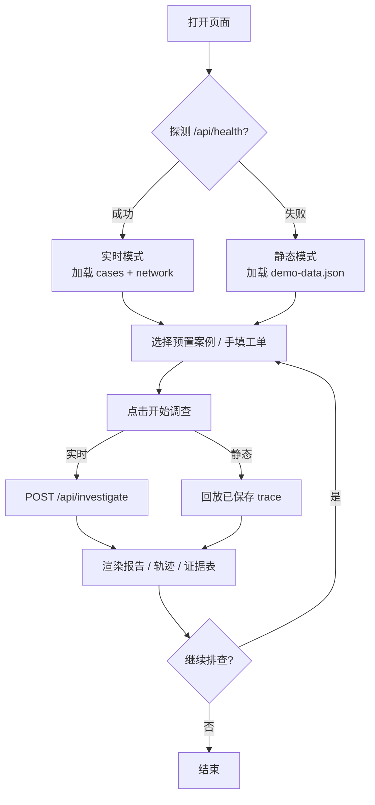

# 前端界面设计文档：NOC-01 校园网延迟调查 Copilot

> 文档版本：v1.0（MVP）
> 小组：李开旭（23211239）、詹林（23271081）　编写：詹林　审阅：李开旭
> 对应实现：[docs/index.html](./index.html) ・ [docs/style.css](./style.css) ・ [docs/script.js](./script.js)
> 设计依据：课程《前端界面设计》专家文档（Purpose / Tone / Constraints / Differentiation + 审美规范）
> 关联文档：[01-项目介绍文档](./01-项目介绍文档.md) ・ [03-后端HLD](./03-后端HLD.md)

---

## 1. 文档目的

本文档说明三件事：

1. 为什么这个界面**长成这样**（设计意图，而非装饰偏好）；
2. 界面由哪些**可复用组件与状态**构成（设计与实现之间的契约）；
3. 界面如何与后端 / 静态演示数据**对接**，以及在异常情况下如何**诚实降级**。

---

## 2. 设计思维（编码前先定方向）

### 2.1 Purpose（目的）

- **解决什么问题**：值班工程师需要在 1 分钟内判断"这次变慢是拥塞、路由还是硬件"，并且要能向同事解释结论。
- **谁使用**：夜班 NOC 一线工程师，长时间盯屏、熟悉命令行、对"花哨卡片"没有耐心。
- **界面要承担的核心动作**：*输入一条工单 → 看 Agent 取证的中间过程 → 读结论*。因此界面不是"营销落地页"，而是**仪表盘 + 工作流**。

### 2.2 Tone（调性）

选择的极端方向：**深夜网络运行中心的工业仪器盘（industrial instrument console）**。

- 深色底、琥珀 + 青色信号色、等宽读数、方形直角、细网格、扫描线；
- 情绪是"冷静、可观测、正在运行"，而不是"温柔、圆润、消费品"；
- 同类参照：机房 KVM、频谱仪、交换机 CLI 的 TUI。

### 2.3 Constraints（约束）

| 约束 | 决策 |
| --- | --- |
| 必须能在 GitHub Pages 运行 | 纯静态 HTML/CSS/JS，**零构建、零打包** |
| 不能假设后端可用 | 必须内置静态演示模式（回放真实 trace） |
| 课堂评审需要直接读源码 | 单文件结构清晰、无框架黑盒；Markdown 渲染手写实现 |
| 中文为主、术语为英文 | 正文用中文无衬线，读数/参数用等宽字体 |
| 可访问性 | 语义化标签、键盘操作、`prefers-reduced-motion` 降级 |
| 网络字体可能被墙/超时 | 字体栈带本地回退：`Noto Sans SC → PingFang SC → Microsoft YaHei` |

### 2.4 Differentiation（差异化记忆点）

**一个点**：页面看起来像一台**正在工作的网络分析仪**，体现在三处：

- 顶部一盏会呼吸的 `LINK` 指示灯，随模式在 `idle / live / offline` 间切换颜色；
- 右上方五格等宽读数条（SOURCE / MODEL / TOOL ROUNDS / CALLS / ELAPSED），调查时 `ELAPSED` 实时跳动；
- 报告正文**逐行淡入**（`animation-delay` 错峰），像设备在逐条打印结论。

用户最后记住的，不是某个按钮，而是"我刚才真的看着它在取证"。

---

## 3. 信息架构

```text
页面
├─ 顶栏 Topbar
│   ├─ 品牌：NOC-01 / CAMPUS LATENCY COPILOT
│   └─ 状态：LINK 指示灯 · 当前模式 · 版本号
├─ 主区 Console
│   ├─ 左轨 Rail（输入与概览）
│   │   ├─ 01 故障工单
│   │   │   ├─ 预置案例下拉
│   │   │   ├─ 模拟网络状态下拉
│   │   │   ├─ 工程师描述 textarea
│   │   │   ├─ 接口密钥（可折叠，默认收起）
│   │   │   ├─ Skill 开关
│   │   │   ├─ 工具预算滑杆
│   │   │   └─ 开始调查按钮
│   │   └─ 02 链路健康
│   │       └─ 6 条链路：名称 · RTT · 利用率条
│   └─ 右舞台 Stage（结果）
│       ├─ 五格读数条
│       ├─ 提示横幅 Banner（warning / error / info）
│       └─ 三视图 Tabs
│           ├─ 调查报告（Markdown 渲染）
│           ├─ 工具轨迹（call → result）
│           └─ 证据表（链路指标汇总 + 时延分解 + 原始 JSON）
└─ 页脚 Footer（项目名 · 运行模式 · 数据来源说明）
```

---

## 4. 用户流程



关键设计：**两条路径的最终渲染完全一致**，区别只体现在 `SOURCE` 读数与顶部横幅的措辞上。这样"演示模式"不会变成另一套 UI，降低维护与讲解成本。

---

## 5. 布局与栅格

### 5.1 线框图（桌面 ≥ 1080px）

```text
┌──────────────────────────────────────────────────────────────────────────┐
│ NOC-01  CAMPUS LATENCY COPILOT              ● LINK   MODE·实时后端  v0.1 │
├──────────────────┬───────────────────────────────────────────────────────┤
│ 01 故障工单       │  SOURCE │ MODEL │ TOOL ROUNDS │ CALLS │ ELAPSED       │
│  ┌────────────┐  ├───────────────────────────────────────────────────────┤
│  │ 预置案例 ▾  │  │  ⚠ 提示横幅（降级 / 静态回放时出现）                  │
│  │ 网络状态 ▾  │  ├───────────────┬───────────────┬───────────────────────┤
│  │ 描述……      │  │ 调查报告(active)│ 工具轨迹      │ 证据表                │
│  │ 密钥（折叠）│  ├───────────────┴───────────────┴───────────────────────┤
│  │ Skill 开关  │  │                                                       │
│  │ 预算 ──●──  │  │   报告正文（逐行淡入）                                 │
│  │ [开始调查 →]│  │                                                       │
│  └────────────┘  │                                                       │
│ 02 链路健康       │                                                       │
│  link-dist-a-sw1  │                                                       │
│  ▓▓▓▓▓▓░░ 78ms   │                                                       │
├──────────────────┴───────────────────────────────────────────────────────┤
│ 课程项目 · 校园网延迟调查 Agent · backend live · 静态演示数据来自 run4     │
└──────────────────────────────────────────────────────────────────────────┘
```

- 主栅格：`300px | minmax(0, 1fr)`，`gap: 30px`，最大宽度 `1560px`；
- 所有面板 `border-radius: 0`，用 1px 边框 + 四角 tick 标记建立"仪器"质感；
- 左轨固定宽度，保证输入区稳定；右舞台自适应，报告长文不被挤压。

### 5.2 响应式断点

| 断点 | 行为 |
| --- | --- |
| `> 1080px` | 双栏，读数条 5 列 |
| `≤ 1080px` | 左轨收窄至 300px，读数条降为 3 列 + 换行 |
| `≤ 880px` | 单栏纵向堆叠，读数条 2 列，内边距收紧 |

---

## 6. 视觉规范

### 6.1 色彩（CSS Variables）

| Token | 值 | 用途 |
| --- | --- | --- |
| `--ink` | `#06090c` | 页面底色（近黑，偏冷） |
| `--ink-raise` / `--panel` | `#0a1016` / `#0c141b` | 面板分层 |
| `--panel-raise` | `#101a23` | 面板内嵌块 |
| `--line` / `--line-strong` | `#1b2b37` / `#2c4759` | 分隔线、悬浮线 |
| `--text` / `--text-soft` / `--muted` | `#dce8ef` / `#a9bdc9` / `#6f8595` | 三级文字 |
| `--amber` | `#ffb02e` | 主强调色：动作、告警、品牌 |
| `--cyan` | `#3ee0c8` | 次强调色：实时状态、扫描线、LINK |
| `--red` | `#ff5f56` | 错误 / 高危指标 |
| `--grid` | `rgba(94,132,156,.11)` | 背景网格 |

**配色立场**：深底 + 双信号色（琥珀=人工动作，青色=系统状态），不使用白底紫渐变、不使用彩虹色板。危险值用红色而不是"渐变色"，保证在色弱场景下仍可依靠位置与数值判断。

### 6.2 字体

| 角色 | 字体 | 理由 |
| --- | --- | --- |
| 展示（Display） | **Chakra Petch** 500/600/700 | 带切角的工业感字体，与"仪器"调性一致；用于品牌、面板标题 |
| 读数（Mono） | **IBM Plex Mono** 400/500/600 | 数字等宽，读数不跳动；用于指标、trace、参数、JSON |
| 正文（Body） | **Noto Sans SC** 300/400/500/700 | 中文长文可读性；报告中英混排稳定 |

**明确排除**：Inter、Roboto、Arial、系统默认字体，以及 Space Grotesk 等已被过度使用的"AI 感"字体。

### 6.3 空间与形状

- 直角（`border-radius: 0`），避免"圆角卡片 + 柔和阴影"的模板观感；
- 面板四角用 `::before/::after` 画 11×11 的三角 tick，模拟设备面板的定位角标；
- 面板标题前加两位编号（`01` / `02`），建立"操作手册"式秩序；
- 小标签一律大写 + 加字距（`letter-spacing`），配合等宽字体形成刻度感。

### 6.4 背景与氛围层

| 层 | 实现 | 作用 |
| --- | --- | --- |
| 径向光晕 | 两处 `radial-gradient`（琥珀右上、青色左上） | 打破纯黑，制造机房灯光感 |
| 网格 | 46×46px 线性渐变网格 + 径向遮罩 | 空间参考，向中心聚焦 |
| 扫描线 | 2px 青色渐变线，11s 匀速纵向移动 | 唯一的持续动效，暗示"设备在扫描" |

### 6.5 动效

| 名称 | 时长 / 曲线 | 触发 | 目的 |
| --- | --- | --- | --- |
| `grid-rise` | 1.1s ease-out | 首屏 | 网格轻微缩放淡入 |
| `scan` | 11s linear infinite | 常驻 | 扫描线 |
| `pulse` | 2.4s ease-in-out infinite | LINK 灯 | 呼吸，表示在线 |
| `panel-in` | 0.55s ease-out | 面板入场 | 左右面板错峰进入 |
| `line-in` | 0.42s / 0.35s ease-out | 报告逐行、trace 逐条 | 错峰揭示，形成"打印"节奏 |

降级：`@media (prefers-reduced-motion: reduce)` 下所有动画压缩到 0.001ms，并隐藏扫描线。

---

## 7. 组件清单与状态

| 组件 | 默认态 | 交互态 | 空态 | 异常态 |
| --- | --- | --- | --- | --- |
| 预置案例下拉 | "自定义工单" | 选择后自动填场景 + 描述 | 载入中显示"载入中…" | 失败显示"无法载入案例" |
| 网络状态下拉 | `congestion` | 切换后立即刷新链路健康 | — | — |
| 描述 textarea | 预填拥塞案例 | 支持多行、`Ctrl/Cmd+Enter` 提交 | 空提交时横幅报错 | — |
| 密钥输入 | 折叠，密码框 | 「显示/隐藏」切换 `type` | — | 仅前端校验非空 |
| Skill 开关 | 开启（C 组） | 关闭 = B 组对照 | — | — |
| 预算滑杆 | 5 轮 | 1–8，实时显示数值 | — | 后端 422 兜底 |
| 开始调查按钮 | 琥珀实心 | hover 位移箭头；busy 时禁用并显示"调查中…" | — | 失败横幅显示原因 |
| LINK 指示灯 | `idle` 灰 | `live` 青色呼吸 / `offline` 琥珀 | — | — |
| 读数条 | 全部 `—` | 调查中 ELAPSED 实时计时 | — | — |
| 横幅 Banner | 隐藏 | `info` / `error` 两种配色 | — | 降级、回放、报错均在此说明 |
| 调查报告 | 空态文案 | Markdown 渲染，逐行淡入 | "等待一次调查" | — |
| 工具轨迹 | "尚无工具调用" | `▸ 调用` / `◂ 返回` 交替，JSON 美化 | "未记录到工具调用" | 超长 JSON 截断 2400 字符 |
| 证据表 | "尚无证据" | 链路指标表 + 延迟分解 + 原始 JSON 折叠 | "本次运行没有可展示的链路指标" | `null` 原样显示，不补零 |

### 7.1 指标着色规则

| 条件 | 样式 | 含义 |
| --- | --- | --- |
| 利用率 ≥ 80% 或丢包 ≥ 1.0% | `is-bad`（红） | 高危 |
| 利用率 ≥ 60% 或丢包 ≥ 0.1% | `is-warn`（琥珀） | 预警 |
| 其他 | 中性 | 正常 |
| RTT ≥ 40ms | 红色文字 | 明显异常 |

---

## 8. 数据流与双模式

### 8.1 实时模式（本地后端）

```text
bootLive()
  ├─ GET api/cases                → 填充案例下拉
  └─ GET api/network?scenario=…   → 渲染 6 条链路健康
点击开始调查
  └─ POST api/investigate
       { prompt, scenario, use_skill, max_tool_rounds, api_key? }
     ← { output, trace, stats, scenario, model, source, warning? }
```

- 请求体字段与 `backend/main.py` 的 `InvestigateRequest` 一一对应；
- `source` 取值：`deepseek`（真实云端）/ `mock`（规则回退）；
- `warning` 非空时展示横幅，**不隐藏降级事实**。

### 8.2 静态模式（GitHub Pages）

```text
bootLive() 失败
  └─ bootStatic(error)
       ├─ GET demo-data.json  → cases / network / traces
       └─ 顶部横幅：「静态演示模式：将回放课程实验中保存的真实 Agent trace」
点击开始调查
  └─ 取 traces[caseId]，800–1400ms 模拟延迟后渲染
     source = "demo-replay"
     横幅：来自 C 组真实运行记录，非本次实时生成
```

`demo-data.json` 由 `scripts/build_demo_data.py` 从 `results/repeat/run4/traces/*.json` 生成，保证页面展示的**就是实验里真实发生过的输出**，不是手写假数据。

---

## 9. Markdown 渲染范围

为避免引入第三方库，`script.js` 内置约 100 行的 Markdown 渲染器，支持：

- 标题（`#`–`####`）、水平线、引用；
- 代码块（三反引号）、行内代码；
- 有序 / 无序列表；
- 管道表格（需含分隔行）；
- 段落、粗体、链接。

安全：所有文本先经过 `esc()` 转义，再拼装标签，**不允许原始 HTML 注入**。不支持嵌套列表、图片、脚注，报告模板本身不需要。

---

## 10. 可访问性

| 项 | 实现 |
| --- | --- |
| 语义结构 | `header / main / aside / section / article / nav / footer` |
| 标签 | 所有输入均有可见 `<label>` 或 `aria-label` |
| 键盘 | Tab 顺序自然；`Ctrl/Cmd + Enter` 提交；按钮为原生 `<button>` |
| Tab 组件 | `role="tablist" / tab / tabpanel` + `aria-selected` 同步 |
| 状态播报 | 报告区域 `aria-live="polite"` |
| 动效 | `prefers-reduced-motion` 全量降级 |
| 对比度 | 正文 `#dce8ef` on `#06090c`，远超 AA；红色仅用于强调不单独承载信息（同时有数值） |

---

## 11. 设计评审清单（对照专家文档）

| 检查项 | 结果 |
| --- | --- |
| 是否先定义 Purpose / Tone / Constraints / Differentiation | ✅ 第 2 节 |
| 是否避免 Inter / Roboto / Arial / 系统字体 | ✅ Chakra Petch + IBM Plex Mono + Noto Sans SC |
| 是否避免白底紫渐变等陈词滥调配色 | ✅ 深底 + 琥珀/青双信号色 |
| 是否有明确的动效编排（而非零散微交互） | ✅ 首屏入场 + 扫描线 + 报告错峰揭示 |
| 是否有背景氛围层（而非纯色） | ✅ 径向光晕 + 网格 + 扫描线 |
| 是否打破常规布局 | ✅ 左轨工具条 + 右舞台仪表盘 + 五格读数条 |
| 是否与场景强相关（而非通用模板） | ✅ 编号面板、tick 角标、LINK 灯、trace 视图均来自 NOC 语境 |
| 是否零构建、可在 Pages 运行 | ✅ 三个静态文件 + 一个 JSON |
| 是否诚实标注降级与回放 | ✅ 横幅 + `SOURCE` 读数 |

---

## 12. 文件与实现对应

| 文件 | 职责 | 规模 |
| --- | --- | --- |
| `docs/index.html` | 语义结构、组件骨架、字体引入 | 171 行 |
| `docs/style.css` | 设计 token、布局、组件样式、动效、响应式 | ~975 行 |
| `docs/script.js` | 状态管理、Markdown 渲染、trace/证据渲染、双模式启动 | ~516 行 |
| `docs/demo-data.json` | 静态模式数据（5 个真实 trace + 拓扑 + 案例） | 55.1 KB |

---

## 13. 后续演进方向

1. **历史对比视图**：把同一链路多次调查的 RTT/利用率画成折线，便于看趋势；
2. **工单系统深链**：URL 携带 `?case=case1_congestion`，方便从工单直接跳转；
3. **浅色主题**：为白天值班场景提供 `prefers-color-scheme: light` 版本（需重新做对比度校准）；
4. **Trace 导出**：一键下载当前 trace JSON，便于附到工单。

以上均为增量功能，不影响现有三文件零构建结构。