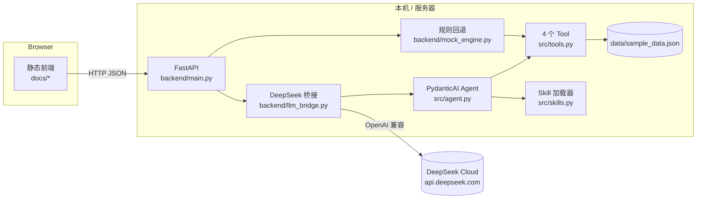
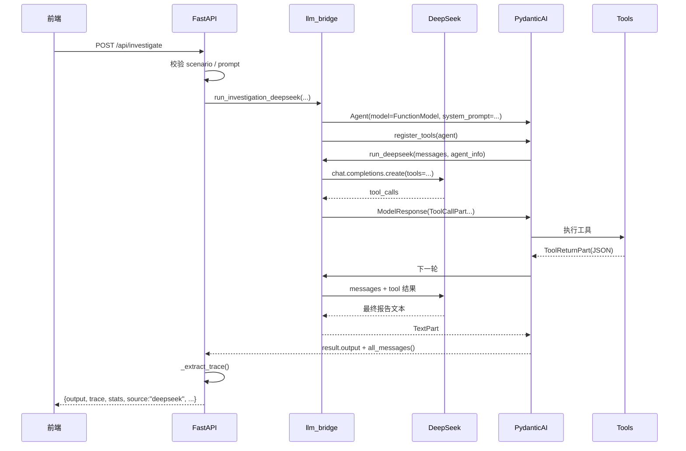

# 后端 HLD（High Level Design）：校园网延迟调查 Agent

> 文档版本：v1.0（第一阶段 MVP）
> 对应实现：`backend/{main,llm_bridge,mock_engine}.py` + `src/{agent,tools,skills}.py`
> 上游文档：[01-项目介绍文档](./01-项目介绍文档.md) ・ [02-前端界面设计文档](./02-前端界面设计文档.md)
> 运行方式：`uvicorn backend.main:app --reload --port 8000`

---

## 1. 文档目的与范围

本文档描述 Web 后端的**高层设计**：系统边界、模块职责、关键流程、接口契约、配置与部署、关键设计决策与已知限制。

范围包含：

- FastAPI 服务（4 个 API + 静态站点托管）；
- DeepSeek 模型桥接层（OpenAI 兼容协议）；
- 与 CLI 共用的 PydanticAI Agent、4 个 Tool 与 Skill 加载逻辑；
- 无 Key / 云端失败时的确定性回退引擎。

不在范围：真实设备接入、数据库、用户认证、分布式部署。

---

## 2. 需求回溯

| 上游需求 | 后端落点 |
| --- | --- |
| FR-01 接收工单并返回报告 | `POST /api/investigate` + `InvestigateRequest.prompt` |
| FR-02 列出链路 | Tool `list_network`（Agent 自主调用） |
| FR-03 查询链路指标 | Tool `get_link_metrics` |
| FR-04 M/M/1 计算 | Tool `calculate_queue_delay` |
| FR-05 时延分解 | Tool `analyze_delay_components` |
| FR-06 工具预算硬限 | `llm_bridge.make_deepseek_function_model` |
| FR-08 无 Key 可用 | `mock_engine.build_mock_result` |
| FR-09 失败降级不白屏 | `main.investigate` 的 `try/except` |
| FR-10 Web/CLI 同一 Agent | `src.agent.register_tools` + `build_system_prompt` |
| 前端数据来源 | `GET /api/cases`、`GET /api/network` |
| 健康检查 | `GET /api/health` |

---

## 3. 系统上下文



外部依赖只有两个：**DeepSeek API**（可缺省）与**本地 JSON 数据**。没有数据库、没有消息队列、没有缓存层——这是课堂级 MVP 的有意取舍。

---

## 4. 分层架构

```text
┌─────────────────────────────────────────────────────────────┐
│ 接入层  backend/main.py                                     │
│  · 路由、请求校验（Pydantic）、CORS、静态站点挂载、降级编排   │
├─────────────────────────────────────────────────────────────┤
│ 传输层  backend/llm_bridge.py                               │
│  · PydanticAI ↔ OpenAI 兼容协议的消息/工具 schema 转换       │
│  · 工具预算硬限、token/调用统计                              │
├─────────────────────────────────────────────────────────────┤
│ 领域层  src/agent.py + src/tools.py + src/skills.py         │
│  · System Prompt、工具实现、Skill 解析与注入                 │
├─────────────────────────────────────────────────────────────┤
│ 兜底层  backend/mock_engine.py                              │
│  · 无 Key / 云端失败时，用真实工具返回 + 固定规则出报告      │
└─────────────────────────────────────────────────────────────┘
```

设计原则：**接入层不写业务规则，传输层不改领域逻辑，兜底层不伪造数据。**

---

## 5. 模块职责

| 模块 | 职责 | 关键实现 |
| --- | --- | --- |
| `backend/main.py` | 应用装配、路由、参数校验、静态托管、降级编排 | `InvestigateRequest/Response`、`app.mount("/", StaticFiles(...))` |
| `backend/llm_bridge.py` | 把 PydanticAI 消息转成 OpenAI `messages`，把工具定义转成 `tools`；执行预算；统计调用 | `_to_openai_messages`、`_openai_tools`、`make_deepseek_function_model` |
| `backend/mock_engine.py` | 确定性规则判读（拥塞 / 硬件 / 待确认 / 正常 / 数据不足） | `_judge`、`build_mock_result` |
| `src/agent.py` | Agent 构造、System Prompt、4 个工具注册、trace 抽取 | `register_tools`、`build_system_prompt`、`_extract_trace` |
| `src/tools.py` | 确定性计算与数据读取，维护当前场景 | `set_active_scenario`、`tool_*` |
| `src/skills.py` | 解析 `SKILL.md` 的 YAML 前置元数据 + 正文，运行时注入 | `load_skill_prompt` |
| `data/sample_data.json` | 拓扑 + 5 套场景指标 | 7 节点 / 6 链路 |
| `tests/cases.json` | 5 个测试案例 | 供 `/api/cases` 读取 |

### 5.1 为什么 Agent 构造要抽成 `register_tools()`

CLI 走 Ollama，Web 走 DeepSeek。若各自复制一份工具定义，两边的工具名、参数 schema、描述迟早分叉，实验结论也会失真。因此：

```python
def register_tools(agent: Agent[None, str]) -> None:
    """把同一套 4 个工具注册到任意 Agent。"""
```

- CLI：`build_agent()` → `register_tools(agent)`；
- Web：`run_investigation_deepseek()` → `register_tools(agent)`。

两者共用 `SYSTEM_PROMPT_BASE`、5 轮预算说明、5 段报告格式与 Skill 注入逻辑，**只有 transport 不同**。

---

## 6. 关键流程

### 6.1 正常路径（有 Key）



### 6.2 无 Key 路径

```text
POST /api/investigate
  → 读 payload.api_key 或 DEEPSEEK_API_KEY
  → 为空
  → mock_engine.build_mock_result(scenario, prompt)
      ├─ set_active_scenario(scenario)
      ├─ tool_list_network()            → trace[0..1]
      ├─ 对 6 条链路逐条 get_link_metrics → trace[2..13]
      └─ _judge(rows) → (root_cause, confidence, rationale)
  → 返回 source="mock"，warning="未配置 DEEPSEEK_API_KEY…"
```

`mock` 的含义是**没有调用大模型**，不是"没有数据"：报告中所有数值都来自真实工具返回值，并显式声明"不是大模型生成"。

### 6.3 云端失败路径

```text
try:  run_investigation_deepseek(...)
except Exception as exc:
      build_mock_result(...)
      warning = f"DeepSeek 调用失败，已回退到离线规则判读：{exc}"
```

实测：传入无效 Key 时 DeepSeek 返回 `401 Authentication Fails`，后端捕获后回退，前端横幅展示该原因，页面不白屏。

### 6.4 工具预算的执行位置

预算不在 Agent 循环里"数次数"，而是在**模型边界**执行：

```python
tool_rounds = stats.get("tool_rounds", 0)
allow_tools = tool_rounds < max_tool_rounds

if not allow_tools:
    payload_messages.append({"role": "user", "content": "工具调用预算已用完。请…立即给出最终调查报告…"})
    # 并且不传 tools
```

效果：预算耗尽后模型**物理上无法再发起工具调用**，只能输出报告。这比"提示模型别调了"可靠，也保证了 0.8B 小模型不会死循环。

---

## 7. 接口契约

### 7.1 `GET /api/health`

```json
{
  "status": "ok",
  "service": "campus-noc-copilot",
  "version": "0.1.0",
  "model": "deepseek-chat",
  "base_url": "https://api.deepseek.com",
  "has_api_key": false,
  "scenarios": ["normal", "congestion", "route_change", "packet_loss", "incomplete_data"]
}
```

用于前端启动探测：任一字段读取失败即切静态模式。

### 7.2 `GET /api/cases`

返回 `tests/cases.json` 原文：

```json
{ "cases": [ { "id": "case1_congestion", "name": "...", "scenario": "congestion", "prompt": "...", "expected_root_cause": "...", "...": "..." } ] }
```

### 7.3 `GET /api/network?scenario=congestion`

```json
{
  "topology": { "nodes": [...], "links": [...] },
  "scenario": "congestion",
  "description": "…",
  "metrics": { "link-dist-a-sw1": { "utilization": 0.94, "rtt_ms": 85.2, "...": "..." } },
  "scenarios": ["normal", "congestion", "..."]
}
```

未知场景 → `400`，`detail` 中列出可选值。

### 7.4 `POST /api/investigate`

请求：

| 字段 | 类型 | 默认 | 约束 |
| --- | --- | --- | --- |
| `prompt` | string | — | 最少 4 字符 |
| `scenario` | string | `congestion` | 必须是已知场景 |
| `use_skill` | bool | `true` | 关闭 = B 组对照 |
| `max_tool_rounds` | int | `5` | 1–8 |
| `api_key` | string \| null | `null` | 留空则用服务端 `.env` |

响应：

```json
{
  "output": "## 问题概述\n…（Markdown 报告）",
  "trace": [
    { "tool_call": "list_network", "args": {} },
    { "tool": "list_network", "result": "{...}" }
  ],
  "stats": { "tool_rounds": 5, "llm_calls": 6 },
  "scenario": "congestion",
  "model": "deepseek-chat",
  "source": "deepseek",
  "warning": null
}
```

错误码：

| 状态 | 场景 |
| --- | --- |
| `400` | 未知 `scenario` |
| `422` | `prompt` 过短 / `max_tool_rounds` 越界（Pydantic 校验） |
| `200 + source=mock + warning` | 无 Key 或云端调用失败（**有意不返回 5xx**） |

> 设计取舍：演示场景下"有结果但标注降级"比"报错页"更有用；错误原因通过 `warning` 原样透出，不掩盖。

---

## 8. 数据模型

### 8.1 trace 步骤

`trace` 是 `tool_call` / `tool` 交替的扁平数组，由 `src.agent._extract_trace()` 从 PydanticAI 消息历史生成：

```json
{"tool_call": "get_link_metrics", "args": {"link_id": "link-dist-a-sw1"}}
{"tool": "get_link_metrics", "result": "{\"link_id\":\"link-dist-a-sw1\",\"utilization\":0.94,...}"}
```

`result` 是 JSON **字符串**（不是对象），这样前端可以直接展示原文，也避免后端二次序列化失真。

### 8.2 统计数据

| 键 | 含义 | 来源 |
| --- | --- | --- |
| `tool_rounds` | 模型真正发起工具调用的轮数 | 桥接层累加 |
| `llm_calls` | 调用云端模型的次数 | 桥接层累加 |

`mock` 路径下 `llm_calls=0`、`tool_rounds=1`、`trace` 共 14 步（1 次列表 + 1 次返回 + 6 条链路 × 2）。

---

## 9. 配置项

| 环境变量 | 默认值 | 说明 |
| --- | --- | --- |
| `DEEPSEEK_API_KEY` | 空 | 为空时走规则回退 |
| `DEEPSEEK_MODEL` | `deepseek-chat` | 模型名 |
| `DEEPSEEK_BASE_URL` | `https://api.deepseek.com` | 兼容网关 / 代理地址 |
| `OLLAMA_HOST` | `http://localhost:11434` | 仅 CLI 使用 |
| `OLLAMA_MODEL` | `qwen3.5:0.8b` | 仅 CLI 使用 |

加载顺序：`payload.api_key`（页面临时填写） > `.env` / 进程环境变量。

---

## 10. 关键设计决策（ADR）

### ADR-1：Web 与 CLI 共用同一个 Agent

- **决策**：抽出 `register_tools()`，两条入口只替换 `FunctionModel`。
- **理由**：避免工具契约分叉；报告可以宣称"同一 Agent，仅 transport 不同"，实验结论可迁移。
- **代价**：`src/agent.py` 需要保持无 Web 依赖（`openai` 在桥接层懒加载）。

### ADR-2：工具预算在模型边界执行

- **决策**：预算耗尽即撤掉 `tools` 参数并追加"立即输出报告"指令。
- **理由**：小模型不遵守"请勿再调用"的软提示；硬撤 schema 才能保证终止。
- **代价**：最后一轮报告质量取决于已有证据；通过 Skill 要求"先查关键链路"缓解。

### ADR-3：降级用规则判读，而不是返回错误

- **决策**：无 Key / 云端异常时，用真实工具返回 + 固定阈值规则生成报告，标注 `source="mock"`。
- **理由**：课堂演示常在无网/无 Key 环境；空白页对评审毫无价值。
- **代价**：规则判读能力有限（5 类结论），不能替代模型推理；必须在前端显式提示。

### ADR-4：静态站点挂载在 `/`，API 路由先注册

- **决策**：`app.mount("/", StaticFiles(directory=docs, html=True))` 放在所有 `/api/*` 之后。
- **理由**：同一套 `docs/` 既能被 FastAPI 托管，又能直接作为 GitHub Pages 的发布目录，零路径改写。
- **代价**：新增 API 必须写在 `mount` 之前，否则会被静态托管吞掉（代码中有注释提示）。

### ADR-5：用 `openai` SDK 直连 DeepSeek，弃用 LiteLLM

- **背景**：最初按示例包采用 `litellm` + `deepseek/deepseek-chat`。
- **问题**：本机环境下 `import litellm` 抛 `cannot import name 'CacheableResult' from 'mcp.types'`（liteLLM 与已安装 `mcp` 包版本冲突），导致所有带 Key 的请求都回退到 mock。
- **决策**：改用已安装的 `openai` SDK，设置 `base_url="https://api.deepseek.com"`，模型名 `deepseek-chat`。
- **验证**：无效 Key 返回 `401 Authentication Fails`，证明请求真实到达 DeepSeek；`/api/health` 的 `model` 字段为 `deepseek-chat`。
- **代价**：失去 LiteLLM 的多供应商统一接口；本项目只需 DeepSeek，可接受。

---

## 11. 错误处理与降级矩阵

| 情形 | 检测点 | 行为 | 前端表现 |
| --- | --- | --- | --- |
| 未配置 Key | `_deepseek_key()` 为空 | 规则判读 | `SOURCE=mock` + 横幅说明 |
| Key 无效 / 余额不足 | `openai` 抛异常 | 规则判读 | 横幅含 401 原文摘要 |
| 网络超时 / DNS 失败 | `openai` 抛异常 | 规则判读 | 同上 |
| 模型返回非法 tool 参数 | PydanticAI 重试机制（`retries=3`） | 重试后继续 | 无感 |
| 预算耗尽 | 桥接层 | 强制输出报告 | `TOOL ROUNDS` 显示上限值 |
| 未知场景 | 路由校验 | `400` | 横幅报错 |
| `prompt` 过短 | Pydantic | `422` | 前端已做空值拦截 |
| 静态数据缺失 | 前端 `bootStatic` | 横幅报错 | "前端初始化失败" |

原则：**任何一层失败都不能让用户看到空白页，也不能让用户误以为是实时结果。**

---

## 12. 安全与隐私

| 项 | 措施 |
| --- | --- |
| API Key 存储 | 只从 `.env` 或请求体读取；不写日志、不落盘；`.env` 在 `.gitignore` 中 |
| 页面内 Key | 仅通过本机 HTTP 发往 `/api/investigate`，请求结束后不保留 |
| 数据 | 全部为教学模拟数据，不含真实用户信息 |
| Prompt 注入 | 工具返回为固定 JSON，不接受外部自由文本；风险面小 |
| CORS | MVP 阶段 `allow_origins=["*"]`，便于本地联调；生产需收紧为具体域名（已列入遗留问题） |
| 依赖 | 不引入重型框架；`openai`、`fastapi`、`uvicorn`、`python-dotenv` 版本在 `requirements.txt` 固定下限 |

---

## 13. 性能与容量

| 指标 | 实测 / 预期 |
| --- | --- |
| `/api/health`、`/api/cases`、`/api/network` | 毫秒级（本地 JSON 读取） |
| 无 Key 规则判读 | < 100 ms（纯本地计算） |
| DeepSeek 单次调查 | 取决于模型与工具轮数；默认 5 轮上限，`max_tokens=2048` |
| 并发 | FastAPI 同步路由跑在线程池；单机课堂级够用 |

**已知并发缺陷**：`src/tools.py` 用模块级 `_ACTIVE_SCENARIO` 保存当前场景。两个并发请求若使用不同 `scenario`，后写入者会覆盖前者，导致工具读到错误场景。当前 MVP 面向单人演示，未加锁；生产化改造方案见第 16 节。

---

## 14. 部署

### 14.1 本地 / 服务器

```bash
pip install -r requirements.txt
uvicorn backend.main:app --reload --port 8000
# 浏览器打开 http://127.0.0.1:8000
```

- `/` 返回 `docs/index.html`，`/style.css`、`/script.js`、`/demo-data.json` 由同一静态挂载提供；
- `/api/*` 优先于静态挂载；
- 可选：`cp .env.example .env` 并填入 `DEEPSEEK_API_KEY`。

### 14.2 GitHub Pages（纯静态）

GitHub Pages **不能运行 Python**。因此线上主页只启用静态模式：

- 发布源：`main` 分支 `/docs` 目录（或 `/` 根目录，取决于仓库布局）；
- `docs/` 内文件自包含，`demo-data.json` 提供真实 trace 回放；
- 页面顶部横幅与 `SOURCE` 读数会明确标注"静态演示 / 非实时生成"。

### 14.3 若要公开实时后端

前端仍在 Pages，后端需部署到可运行 Python 的平台（Render / Railway / Fly.io / 自有服务器），并把 `fetch("api/…")` 改为后端绝对地址（或加反向代理）。本期不做，属后续演进。

---

## 15. 可观测性

| 手段 | 内容 |
| --- | --- |
| `GET /api/health` | 服务状态、模型、base_url、是否配置 Key、可用场景 |
| `stats` | `tool_rounds`、`llm_calls`，前端读数条直接展示 |
| `trace` | 每次工具调用与返回原文，前端「工具轨迹」视图 |
| `warning` | 降级原因原样透出 |
| 自检 | `python -m backend.main` 打印 health 与 mock stats |

暂未接入结构化日志与指标上报——MVP 阶段以"响应体自带可观测信息"为主。

---

## 16. 可扩展点

| 方向 | 改造位置 | 说明 |
| --- | --- | --- |
| 消除场景全局态 | `src/tools.py` | 用 `contextvars.ContextVar` 或在工具参数中显式传 `scenario` |
| 多模型供应商 | `backend/llm_bridge.py` | 新增 `make_<provider>_function_model`，复用同一 `register_tools` |
| 真实设备接入 | `src/tools.py` | 把 JSON 读取替换为 SNMP / gNMI / 控制器 API |
| 流式输出 | `backend/main.py` | 改为 `StreamingResponse` + SSE，前端逐步渲染 |
| 多轮对话 | `src/agent.py` | 复用 `message_history`，保留上下文 |
| 鉴权与配额 | `backend/main.py` | 增加 API Key 中间件、限流 |
| 持久化 trace | `results/` / DB | 支持工单复盘与跨班次对比 |

---

## 17. 测试与验收

### 17.1 自检

```bash
python -m backend.main
```

预期输出包含 `"status": "ok"`、`"model": "deepseek-chat"`、5 个场景，以及 mock 的 `{"tool_rounds": 1, "llm_calls": 0}`。

### 17.2 接口冒烟

| 用例 | 期望 |
| --- | --- |
| `GET /api/health` | `200`，`has_api_key` 反映真实配置 |
| `GET /api/cases` | `200`，`cases.length == 5` |
| `GET /api/network?scenario=route_change` | `200`，6 条链路 |
| `GET /api/network?scenario=xxx` | `400`，`detail` 列出可选场景 |
| `POST /api/investigate` 无 Key | `200`，`source=mock`，`trace` 14 步，`warning` 非空 |
| `POST /api/investigate` 假 Key | `200`，`source=mock`，`warning` 含 `401` |
| `GET /` | `200`，返回 `index.html` |
| `GET /style.css`、`/script.js`、`/demo-data.json` | `200` |

### 17.3 前端联调

浏览器打开 `http://127.0.0.1:8011`：

1. 顶栏 `MODE · 实时后端`、`LINK` 青色呼吸；
2. 链路健康显示 6 条链路及利用率条；
3. 选案例 → 开始调查 → 三视图均有内容；
4. 停掉后端刷新页面 → 自动切静态模式，横幅提示回放来源。

---

## 18. 已知问题

| # | 问题 | 影响 | 计划 |
| --- | --- | --- | --- |
| 1 | `_ACTIVE_SCENARIO` 为进程级全局变量 | 并发不同场景会串数据 | 改 `contextvars` |
| 2 | CORS 为 `*` | 生产不安全 | 部署时收紧 |
| 3 | 无鉴权与限流 | 公网暴露会被滥用 | 加中间件 |
| 4 | 规则回退仅覆盖 5 类判断 | 复杂工单能力有限 | 明确标注，后续补规则 |
| 5 | 静态模式只回放固定 5 条 trace | 不能自由输入 | 属 Pages 固有限制，已提示 |

---

## 19. 小结

后端的核心不是"多复杂"，而是**边界清楚**：

- **Agent 决定查什么**，代码不替它编排；
- **Tool 决定算出什么**，模型不许心算；
- **桥接层决定何时停**，预算硬限兜底；
- **接入层决定失败怎么办**，降级必须诚实；
- **文档决定为什么这样设计**，每个 ADR 都有可验证的后果。

这套结构使同一个 Agent 既能跑在本地 Ollama 的 CLI 里，也能跑在 DeepSeek 的 Web 后端里，而实验数据与用户看到的行为保持一致。