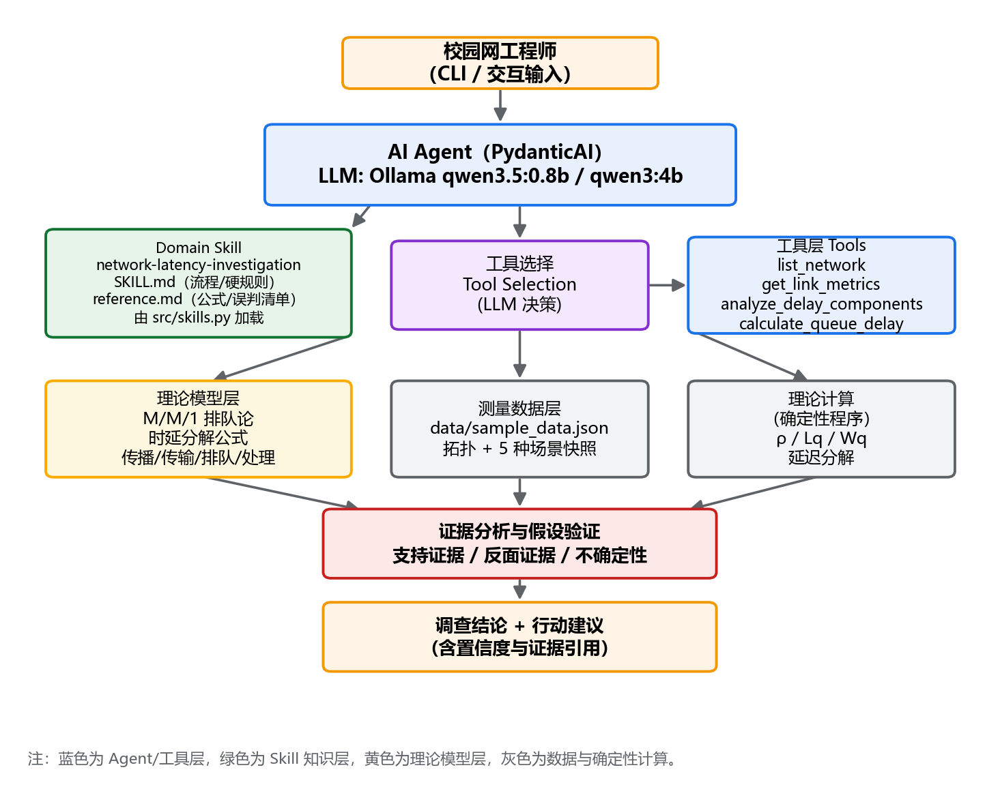
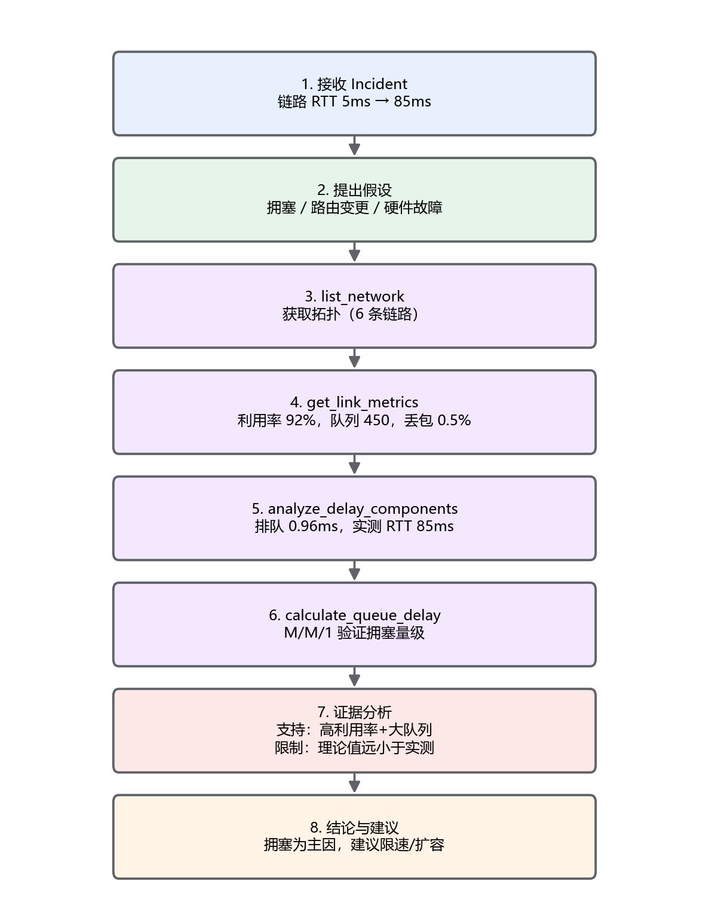
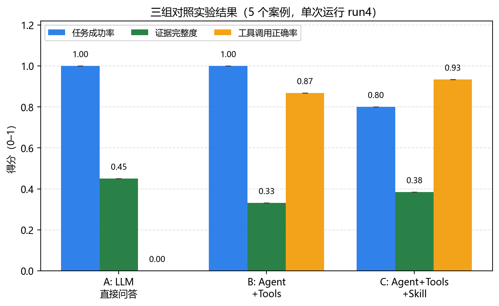
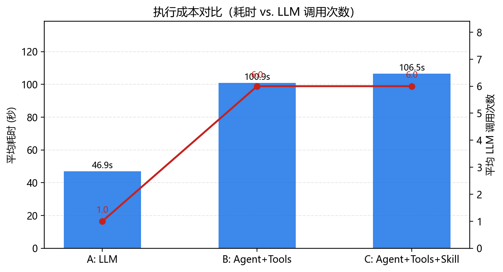
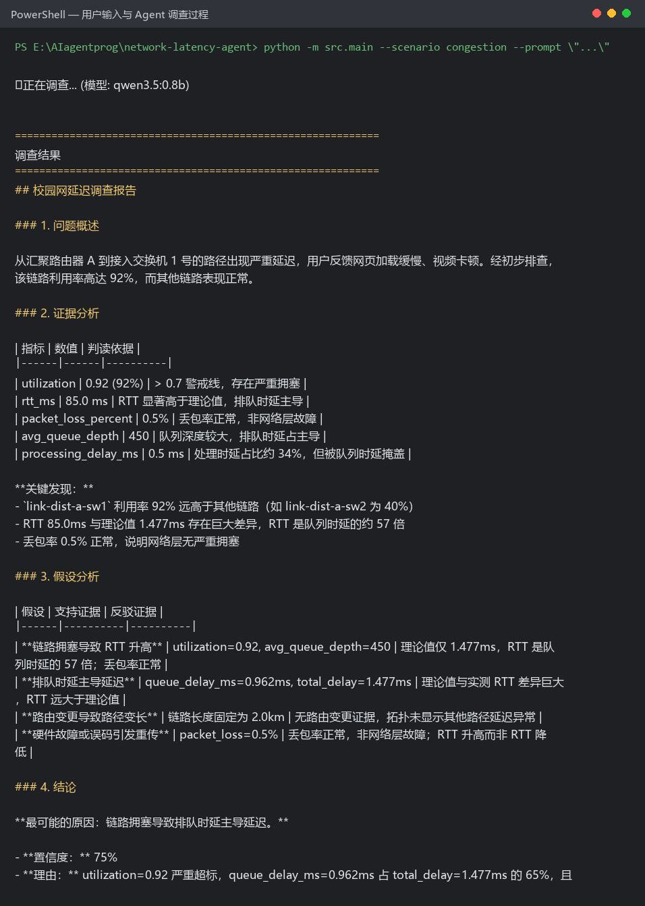
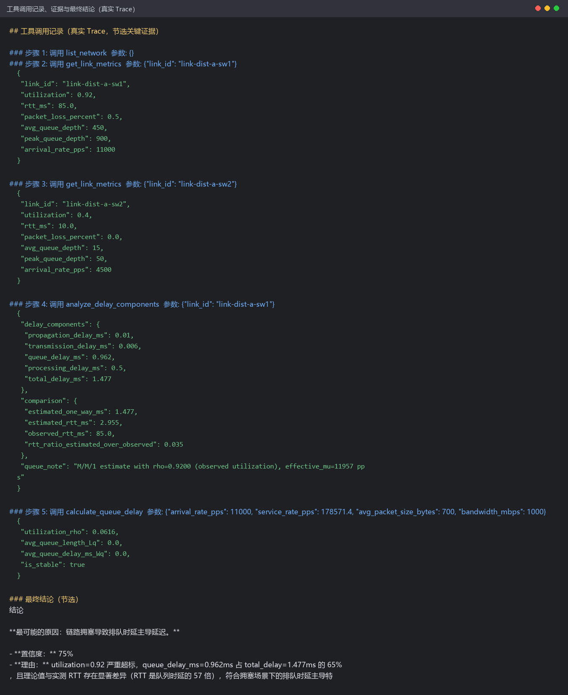
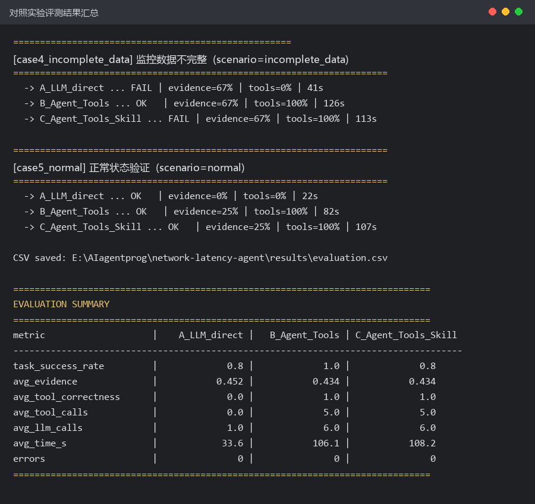

# 校园网延迟调查 AI Agent 的设计与实现

**课程：《人工智能的网络应用》综合项目**

| 项目 | 内容 |
| --- | --- |
| 项目名称 | 面向校园网运维的网络延迟调查 AI Agent |
| 学生姓名 | （填写） |
| 学号 | （填写） |
| 大语言模型 | Ollama 本地部署：qwen3.5:0.8b（评测）、qwen3:4b（备选） |
| Agent 框架 | PydanticAI |
| 提交日期 | 2026-10-31 |

---

## 摘要

本项目面向校园网运维工程师，实现了一个能够调查**上联链路延迟异常**的 AI Agent。Agent 不直接回答"这是拥塞"，而是先提出"拥塞／路由变更／硬件故障"三类候选假设，再调用四个工具（拓扑查询、链路指标查询、时延分解、M/M/1 排队论计算）收集证据，最后比较实测 RTT 与理论时延、检查利用率与丢包率的组合特征，形成带置信度的结论与行动建议。

项目的核心是把课堂上学的**排队论与时延分解理论**变成 Agent 可以确定性调用的计算工具，并用一份分层的 `SKILL.md`（60 行正文承载调查流程、四条硬性规则与判读表，公式推导与误判清单下沉到 `reference.md`）约束 Agent 的推理过程。为检验有效性，本项目设计了 5 个覆盖"普通拥塞／路由变更／硬件故障／数据缺失／正常状态"的测试案例，并以"直接询问 LLM""LLM+Agent+Tools""LLM+Agent+Tools+Skill"三组配置做对照实验。

实测结果表明：直接询问 LLM 的任务成功率虽然同为 1.00，但它的"证据"只是复述提示词里的监控快照，**不具备任何可核查的测量过程**；引入工具后，Agent 能真实调用测量与计算工具（工具调用正确率 0.868），每一次取值都能回溯到 trace；叠加专业 Skill 后，工具调用正确率升到 0.934、证据完整度从 0.332 升到 0.384。实验同时暴露出三个重要局限：小模型在数据缺失场景下曾给出 85% 的高置信度错误结论（Skill v2 消除了"编造其他链路正常"这一幻觉，但输出会退化成重复段落）；在"低利用率 + 高丢包"的硬件故障案例上，Skill 只能阻止它把数量级差异说成"吻合"，仍不能让它选中正确原因；关键词式评测指标会把不合格的回答**误判为通过**——必须结合工具调用 trace 人工复核。

**关键词**：网络运维；AI Agent；排队论；M/M/1；时延分解；Skill Engineering

---

## 第一部分 项目背景与问题定义

### 1.1 目标用户

目标用户是**校园网运维工程师**。校园网通常采用"核心—汇聚—接入"三层结构，一台核心路由器下挂多台汇聚路由器，汇聚路由器再连接若干接入交换机。运维工程师日常需要面对大量"某条链路慢"的工单。

### 1.2 要解决的具体网络问题

本项目聚焦一类具体问题：**上联链路 RTT 显著上升，但原因不明**。

工程师需要回答的不是"网络慢不慢"，而是三个可判定的问题：

1. 这个延迟是**排队延迟**（拥塞）造成的吗？
2. 如果不是，是不是**路由变更**导致路径变长，或者**硬件故障**导致丢包重传？
3. 现有证据是否足以支撑结论？

### 1.3 目前工程师如何处理

典型流程是：登录网管系统 → 逐条链路查看利用率、RTT、丢包率 → 凭经验判断 → 必要时手算排队时延 → 给出结论。这个过程有三个痛点：

- **信息分散**：六条链路的六类指标需要人工比对，容易只看故障链路而漏掉上游。
- **计算易错**：M/M/1 的 $\rho=\lambda/\mu$、$W_q=\rho/[\mu(1-\rho)]$ 手算容易搞错单位（pps 与 bps、字节与比特）。
- **经验依赖**：新手容易"看到 RTT 高就写拥塞"，忽略"高丢包+低利用率"这种典型的硬件故障特征。

### 1.4 为什么需要 AI Agent

单纯的大语言模型做不到这件事，因为：模型**没有实时网络数据**，只能凭空编造利用率数值；模型**不能可靠地做单位换算和排队论计算**；模型**倾向于给出确定答案**，不会主动说"证据不足"。

而一个 Agent 可以：调用工具取得真实数据、调用程序完成确定性计算、按 Skill 规定的工作步骤逐项检查证据、在数据缺失时明确声明不确定性。

### 1.5 本项目要实现的功能

- 接收自然语言的延迟故障描述；
- 自主决定调用哪个工具、调用几次；
- 用 M/M/1 模型计算理论排队时延，并与实测 RTT 比对；
- 把总时延分解为传播／传输／排队／处理四部分；
- 输出含"支持证据、反驳证据、置信度"的调查报告。

### 1.6 本项目明确不解决的问题

- **不连接真实网络设备**：数据来自模拟拓扑与快照（`data/sample_data.json`），不涉及任何未经授权扫描或配置变更。
- **不覆盖 DNS、应用层、无线空口问题**：这些问题需要另一套工具与 Skill。
- **不自动下发配置**：只给建议，不执行变更。
- **不训练模型**：使用现成开源模型本地部署。

### 1.7 典型 Incident

> **事件**：某工作日下午，监控告警显示"汇聚路由器 A → 接入交换机 1 号"链路（`link-dist-a-sw1`）RTT 由正常的 5 ms 上升至 85 ms，多名用户反馈网页加载慢、视频会议卡顿。
>
> **已知条件**：拓扑与链路带宽已知；该链路长度 2.0 km、带宽 1000 Mbps；网管系统可提供利用率、RTT、丢包率、队列深度、到达率。
>
> **调查任务**：判断延迟是否由拥塞引起，排除路由变更与硬件故障，给出处置建议。

---

## 第二部分 系统架构与 Agent 设计

### 2.1 系统架构



架构自下而上分为五层（见图 1）：

1. **数据与模型层**：`data/sample_data.json` 提供网络拓扑（6 条链路、7 个节点）与 5 种场景快照；`models.py` 定义 `LinkConfig`、`LinkMetrics`、`DelayComponents`、`MM1Result` 四个数据结构；理论模型层固化 M/M/1 公式与四类时延分解公式。
2. **工具层**：四个纯 Python 函数，见第三部分。
3. **Skill 知识层**：`skills/network-latency-investigation/SKILL.md`（第三层细节在 `reference.md`），运行时由 `src/skills.py` 解析并注入 System Prompt。
4. **Agent 层**：PydanticAI 的 `Agent` + `FunctionModel` 桥接本地 Ollama。
5. **交互层**：`src/main.py` 提供单次运行与交互两种模式，输出 Markdown 报告与 JSON trace。

### 2.2 为什么选择当前 LLM 与 Agent 框架

- **Ollama + 本地模型**：不依赖网络与 API Key，符合课程"本地部署"要求，且实验可复现。评测使用 `qwen3.5:0.8b`（CPU 上可完成一次完整调查），备选 `qwen3:4b`。
- **PydanticAI**：`@agent.tool_plain` 装饰器可直接把带类型注解的 Python 函数注册为工具，参数用 Pydantic 校验，工具返回结构化 dict，比手写 function-calling 解析更可靠。
- **单 Agent 而非多 Agent**：本任务的调查流程是线性的（看拓扑 → 查指标 → 分解时延 → 验证假设），单 Agent 足够；课程评分原则也明确指出"不因使用多 Agent 自动加分"。

### 2.3 Agent 如何决定调用哪个工具

Agent 依靠 LLM 的推理能力，并结合 System Prompt 中给出的"调查预算"约束：

- 典型调用顺序（由 Skill 给出，C 组可见）：`list_network` → `get_link_metrics`（目标链路 + 一条对照链路）→ `analyze_delay_components` → 必要时 `calculate_queue_delay`；
- **最多 5 轮工具调用**。该上限不写在提示词里就算数，而是**在 `FunctionModel` 内部强制实施**：当 `stats["tool_rounds"]` 达到 5 时，后续请求不再向 Ollama 发送 tool schema，并追加一条"预算已用完，请立即给出结论"的指令。这保证了调查**一定终止**，避免小模型陷入工具调用死循环。

### 2.4 Skill 在什么时候被加载或使用

Skill 不是一个抽象设定，而是磁盘上的目录：`skills/network-latency-investigation/` 下有 `SKILL.md` 与 `reference.md`。`src/skills.py` 在 `build_agent()` 时解析 `SKILL.md` 的 YAML 前置元数据（`name`、`description`）并把正文拼进 System Prompt，因此它在**第一轮推理之前就已经生效**。

这对应 Anthropic Agent Skills 的渐进式披露：第一层是元数据，用来回答"这个 Skill 管不管当前任务"；第二层是 `SKILL.md` 正文，承载真正的方法与判据；第三层是 `reference.md`，放公式推导、量级参考和完整误判清单。

需要说明第三层的实现取舍：本项目的 Agent 只挂载了四个业务工具，**没有文件系统读取工具**，所以 `reference.md` 不会在运行时被自动加载，它由使用者查阅，并在将来接入文件读取工具时可以直接作为按需加载对象。这是当前实现与完整 Skills 机制的差异，不是遗漏。

为了 B/C 对照可归因，System Prompt 被拆成了两部分：

- **BASE（A、B、C 都有）**：只写"有哪些工具、最多 5 轮、输出五段式报告、数值必须来自工具"。没有任何领域判断。
- **Skill（只有 C 组有）**：判断依据、阈值、误判清单、置信度规则、必须承认证据不足的情形。

对照组 B（`use_skill=False`）拿到的是只有工具说明的提示词，与 C 组唯一差别就是这份 Skill，因此 B→C 的差异可以归因于专业知识本身，而不是"多了一段提示词"。

### 2.5 Agent 如何获得工具结果，以及如何转化为结论

工具返回 JSON，PydanticAI 将其作为 `ToolReturnPart` 追加进消息历史，下一轮推理时由 `build_ollama_messages()` 转成 Ollama 的 `role: "tool"` 消息。Agent 被要求"严格引用工具返回的数值"，因此报告中的 92%、85 ms、450 个包等数字都可回溯到 trace。

转化为结论的关键机制是**对比**：`analyze_delay_components` 同时返回"理论估计 RTT"与"实测 RTT"及两者比值，Agent 据此判断——比值接近 1 说明排队延迟可解释大部分延迟；实测远大于理论则说明还有重传、突发流量等其他因素。

### 2.6 工具调用失败、无效输入与数据缺失的处理

代码中做了四层防护：

| 情况 | 处理方式 |
| --- | --- |
| 链路名不存在 | 返回 `{"error": ...}` 并附可用链路列表，让模型自我纠正 |
| 参数类型错误（如 `"1000 / (700*8)"`） | `_as_float()` 强制转换 + `retries=3` 重试 |
| 数据缺失（字段为 `null`） | 返回 `null` 并提示证据不足，不做数值猜测 |
| 模型陷入工具循环 | `max_tool_rounds=5` 后关闭工具，强制输出结论 |
| Agent 整体异常 | `_fallback_answer()` 用快照直接生成兜底结论，标记 `degraded=True` |

### 2.7 典型任务执行流程



图 2 展示一次完整调查的 8 个步骤，与第四部分的实例一一对应。

---

## 第三部分 Tool 与 Skill 的设计和实现

### 3.1 Tool 设计

| 工具名 | 输入 | 输出 | 实际作用 |
| --- | --- | --- | --- |
| `list_network` | 无 | 6 条链路的 id、起止节点、带宽、长度 | 建立拓扑认知，确定要查哪条链路 |
| `get_link_metrics` | `link_id` | 利用率、RTT、丢包率、平均/峰值队列深度、到达率、平均包长 | 取得判断所需的实测证据 |
| `analyze_delay_components` | `link_id`、`processing_delay_ms` | 传播/传输/排队/处理四项时延、总时延、理论 RTT 与实测 RTT 比值 | 定位延迟主导成分 |
| `calculate_queue_delay` | 到达率 λ、服务率 μ、包长、带宽 | ρ、L、Lq、W、Wq、稳定性标记 | 用排队论独立验证拥塞假设 |

**关键实现一：M/M/1 计算（确定性计算，不能让 LLM 心算）**

```python
rho = arrival_rate_pps / service_rate_pps
if rho >= 1.0:
    return {"error": "System unstable! rho >= 1", "is_stable": False}
L  = rho / (1 - rho)          # 系统中平均包数
Lq = rho**2 / (1 - rho)       # 队列中平均包数
W  = L / arrival_rate_pps     # 平均系统时间 (s)
Wq = Lq / arrival_rate_pps    # 平均排队时间 (s)
```

ρ ≥ 1 时不返回数值而返回"系统不稳定"，这是**刻意设计的边界处理**：此时排队时延在理论上无界，给出任何具体数字都是误导。

**关键实现二：时延分解**

```python
prop  = length_km / (299792.458 * speed_factor) * 1000   # ms
trans = (pkt_bytes * 8) / (bandwidth_mbps * 1e6) * 1000  # ms
rho   = observed_utilization                              # 用实测利用率而非理论值
Wq    = rho / (effective_mu * (1 - rho)) * 1000           # ms
```

这里有一个重要的工程取舍：ρ 取**实测利用率**而不是"到达率 ÷ 理论带宽服务率"。因为理论服务率（178571 pps）远大于实际（11957 pps），直接用理论值会算出 ρ=0.06、排队时延 0.006 ms，得出"没有拥塞"的错误结论。**这个坑在实验中真实发生过**，详见 5.5 节。

### 3.2 Skill 设计

**名称**：`network-latency-investigation`；**文件**：`skills/network-latency-investigation/SKILL.md`（正文 60 行），第三层细节在同目录 `reference.md`。

Skill 借鉴了课程提供的通信工程师专家 Skill 的"分层定位 → 链路预算 → 交叉验证"思路，但没有照搬，也没有把教材章节改写成 Markdown。写作时依据三条来自 Skill 编写方法论的判断：**只写模型不知道的**、**把易错环节写成低自由度护栏**、**用祈使句而不是建议句**。

**（1）先分离"模型已经会的"与"模型做不到的"。** 四类时延公式、M/M/1 的 ρ 与 Lq，模型本来就知道个大概；第一轮实验中它真正出错的不是公式，而是三件事：数据缺失时仍给 85% 的高置信度；把相差 280 倍的理论值与实测值说成"高度吻合"；把 `1000 / (700 * 8)` 这样的算式当参数传给工具。所以 v2 把公式、量级表、六条误判清单全部移到 `reference.md`，`SKILL.md` 正文只留判断规则，从 164 行压缩到 60 行。

**（2）把易错点写成硬规则，而不是好建议。** 正文里的四条硬性规则都对应一个观察到的失败：

| 硬规则 | 对应的真实失败（第一轮，见 5.5） |
| --- | --- |
| 数据缺失必须明说，不许用"其他链路正常"补位 | C 组在 case4 编造了没查过的链路状态 |
| 指标缺失时置信度 ≤ 50%，且结论改写为"证据不足" | C 组用"必须给置信度"的旧条款输出了 85% |
| 理论值与实测值差 10 倍以上必须解释 | 模型把 0.071 ms 与 20 ms 说成"高度吻合" |
| 工具参数传纯数值 | 模型传了 `"1000 / (700 * 8)"` 字符串 |

**（3）用判读表替代散落的"注意事项"。** 正文给出一张四行的判读表（利用率 / 丢包 / 队列 → 结论），把"利用率高但丢包为 0 不算拥塞""利用率低但丢包高要看硬件"这类组合判据压成可查表的形式，比逐条叙述更难被忽略。

**（4）用"承认证据不足"作为合格答案。** 正文明确列出四种必须说"证据不足"的情形，并写明"说不知道是合格答案，编一个高置信度结论是错误答案"——这句是针对第一轮实验中过度自信问题的直接对策。

**（5）Skill 是文件，不是提示词里的一段硬编码。** v1 的 Skill 正文实际上被复制进了 `agent.py` 的字符串常量，`SKILL.md` 只是文档。v2 新增 `src/skills.py`，运行时解析 YAML 前置元数据与正文，`SKILL.md` 改动即刻生效，文档与实现不再有两份。

这一轮改造也把 B 组的位置讲清楚了：按"先观察失败、再写规则"的思路，**B 组就是 RED 基线**——它拿着工具但没有专业判断，暴露了模型自然的错误；`SKILL.md` 是针对这些错误写的；**C 组是 GREEN 验证**——同样的任务加上规则后是否真的改进了行为。5.4 与 5.5 报告的就是这次验证的结果。

### 3.3 专业知识的正确性

- **M/M/1 的适用条件**在 Skill 与工具输出中都被显式声明（工具返回 `note` 字段）。本项目的模拟流量由大量独立终端聚合而成，近似满足泊松假设；若是单条大象流则不适用。
- **香农容量不等同于用户吞吐**，本项目未涉及容量计算，但 Skill 中保留了这一条以警示模型不要把"带宽"当成"可用吞吐"。
- **理论时延小于实测时延是正常现象**，因为 M/M/1 只描述平均排队行为，不包含 TCP 重传、缓冲区膨胀、突发到达。因此 Agent 被要求把该差异作为"还有其它因素"的证据，而不是判为"模型算错"。

---

## 第四部分 Agent 的调查过程与工作实例

以 **case1（链路拥塞）** 为例，C 组的完整执行过程如下（数据取自 `results/traces/case1_congestion_C_Agent_Tools_Skill.json`）。

| 步骤 | Agent 的操作 | 获得的信息或结果 |
| --- | --- | --- |
| 1 | 接收 Incident | `link-dist-a-sw1` RTT 5 ms → 85 ms |
| 2 | 提出假设 | 拥塞 / 路由变更 / 硬件故障 |
| 3 | 调用 `list_network` | 确认 6 条链路，目标链路带宽 1000 Mbps、长 2.0 km |
| 4 | 调用 `get_link_metrics` | 利用率 0.92、RTT 85 ms、丢包 0.5%、队列均值 450、峰值 900 |
| 5 | 调用 `analyze_delay_components` | 传播 0.010 ms、传输 0.006 ms、排队 0.962 ms、处理 0.5 ms，合计 1.477 ms |
| 6 | 调用 `calculate_queue_delay` | ρ、Lq、Wq 均远小于实测，说明平均排队不足以解释 85 ms |
| 7 | 证据分析 | 支持拥塞：利用率 92%、队列 450；限制结论：理论 RTT 2.955 ms 仅为实测的 3.5% |
| 8 | 输出结论 | 拥塞为主因，置信度 60%，并明确指出"除拥塞外还有其他因素" |

### 4.1 一次真实的工具调用（输入与返回值）

**调用**：`get_link_metrics(link_id="link-dist-a-sw1")`

```json
{
  "link_id": "link-dist-a-sw1",
  "bandwidth_mbps": 1000,
  "length_km": 2.0,
  "utilization": 0.92,
  "rtt_ms": 85.0,
  "packet_loss_percent": 0.5,
  "avg_queue_depth": 450,
  "peak_queue_depth": 900,
  "arrival_rate_pps": 11000,
  "avg_packet_size_bytes": 700
}
```

**Agent 如何使用**：把 `utilization=0.92` 与 Skill 给出的 0.7 警戒线比较，判定"高负载"；把 `avg_queue_depth=450` 与正常值（<10）比较，判定"队列确实堆积"；把 `packet_loss_percent=0.5` 解读为队列溢出。

**第二个调用**：`analyze_delay_components(link_id="link-dist-a-sw1")` 返回

```json
{"delay_components": {"propagation_delay_ms": 0.01, "transmission_delay_ms": 0.006,
                      "queue_delay_ms": 0.962, "processing_delay_ms": 0.5,
                      "total_delay_ms": 1.477},
 "comparison": {"estimated_rtt_ms": 2.955, "observed_rtt_ms": 85.0,
                "rtt_ratio_estimated_over_observed": 0.035}}
```

### 4.2 支持某假设的证据

利用率 0.92（远超 0.7 警戒线）+ 平均队列深度 450（正常值 < 10）+ 0.5% 丢包 → 三条独立指标同时指向**排队拥塞**，这是支持"拥塞"假设的核心证据链。

### 4.3 反驳或限制结论的证据

`estimated_rtt_ms=2.955` 仅为 `observed_rtt_ms=85` 的 3.5%。若延迟纯粹来自平均排队，实测 RTT 应接近理论值。这一巨大差异**限制了"单靠排队解释全部延迟"的结论**，提示还存在突发到达、TCP 重传或缓冲区膨胀。Agent 在结论中确实写道"RTT 升高到 85 ms 与理论排队延迟相差巨大，说明除拥塞外还有其他因素"，置信度只给 60% 而非 90%，这一克制是 Skill 中"承认不确定性"条款起作用的直接表现。

### 4.4 最终结论

> 最可能原因为**链路拥塞导致排队延迟增加**，置信度 60%。建议：核查 `link-dist-a-sw1` 的流量构成并考虑限速或扩容；同时对 0.5% 丢包与队列峰值 900 设置告警。

---

## 第五部分 实验设计、评测结果与分析

### 5.1 测试案例

| Case | 名称 | 场景 | 预期根因 | 难点 |
| --- | --- | --- | --- | --- |
| 1 | 链路拥塞 | `congestion` | 拥塞（排队延迟） | 需用 M/M/1 佐证 |
| 2 | 路由变更 | `route_change` | 主链路中断 + 备用路径过载 | 需发现"另一条链路 100% 丢包" |
| 3 | 硬件故障 | `packet_loss` | 光模块故障致高丢包 | 高丢包 + 低利用率，易误判为拥塞 |
| 4 | 数据不完整 | `incomplete_data` | 部分数据缺失下的谨慎结论 | 必须说明证据不足 |
| 5 | 正常状态 | `normal` | 无异常 | 检验是否误报 |

五个案例分别对应"常规可解""需要专业计算""含错误线索""信息不足""边界不误报"，不是同一问题改数字。每个案例的"正确答案"由模拟数据生成时即确定（`tests/cases.json` 中的 `expected_root_cause`），因此评判标准是客观的。

### 5.2 对照实验设计

三组配置使用**同一模型、同一提示词、同一份数据**，唯一差别是可用信息范围：

| 实验组 | 配置 | 可获得的信息 |
| --- | --- | --- |
| A | 直接询问 LLM | 完整监控快照以 JSON 文本形式贴在提示词中，**无工具、无 Skill** |
| B | LLM + Agent + Tools | 仅通过工具调用获取数据，**无 Skill** |
| C | LLM + Agent + Tools + Skill | 工具 + Skill 知识 |

A 组并非"什么都不给"——它拿到了与 B/C 完全相同的数据，只是**没有测量过程与计算方法**。这样才能公平地检验"工具和 Skill 本身"的价值。

### 5.3 评测指标定义

| 指标 | 计算方式 |
| --- | --- |
| 任务成功率 | 最终答案命中该案例"区分性关键词"的案例比例。区分性关键词按案例定制，例如 case1 必须出现"拥塞"，case4 必须出现"数据不足/不完整/缺失/无法确定"之一 |
| 证据完整度 | 命中的预期证据点数 ÷ 该案例预期证据点总数 |
| 工具调用正确率 | 三项各占 1/3：是否调用 `get_link_metrics`、是否调用 `analyze_delay_components`、是否查询了目标链路 |
| 执行成本 | 平均 LLM 调用次数与端到端耗时（秒） |

指标全部由 `tests/evaluate.py` 自动计算，不依赖主观打分。

### 5.4 评测结果



**表 1 对照实验结果（Skill v2，qwen3.5:0.8b，5 个案例，`results/repeat/run4/`）**

| 指标 | A：直接 LLM | B：Agent + Tools | C：Agent + Tools + Skill |
| --- | ---: | ---: | ---: |
| 任务成功率 | **1.00** | **1.00** | 0.80 |
| 证据完整度 | **0.450** | 0.332 | 0.384 |
| 工具调用正确率 | 不适用（0.00） | 0.868 | **0.934** |
| 平均工具调用次数 | 0 | 5.0 | 5.0 |
| 平均 LLM 调用次数 | 1.0 | 6.0 | 6.0 |
| 平均耗时（秒） | **46.9** | 100.9 | 106.5 |
| 异常次数 | 0 | 0 | 0 |

这与"Skill 一定提升所有指标"的直觉不符，需要如实说明两点：**其一**，A 组拿到的是完整快照，指标数值直接贴在提示词里，它的"证据完整度"只是复述，不代表测量能力；**其二**，只有 5 个案例、判别方式是关键词命中，成功率这一列已经**饱和**——三组都能答对所有"常规可解"的案例，区分度落在逐案例细节上。

**表 2 逐案例明细（run4，括号内为证据完整度）**

| 案例 | A | B | C |
| --- | --- | --- | --- |
| case1 拥塞 | 通过（0.33） | 通过（0.33） | 通过（0.33） |
| case2 路由变更 | 通过（0.67） | 通过（0.33） | 通过（0.67） |
| case3 硬件故障 | 通过（0.25） | 通过（0.00） | **失败**（0.00） |
| case4 数据缺失 | 通过（1.00） | 通过（1.00） | 通过（0.67） |
| case5 正常状态 | 通过（0.00） | 通过（0.00） | 通过（0.25） |



图 3 与图 4 直接由 `results/repeat/run4/summary.json` 绘制（`python scripts/make_figures.py --run run4`），不含前两次实验，原因是这三轮实验的实验条件并不相同，见下。

**表 3 版本与基线变更说明（为什么不能把三轮数字直接平均）**

| 轮次 | Skill 版本 | B/C 组的 BASE 提示词 | 能否与 run4 合并统计 |
| --- | --- | --- | --- |
| run2 | v1（164 行，含公式与量级表） | 含"RTT 升高不等于拥塞""M/M/1 有适用条件"等**领域判断** | 否 |
| run3 | v1 | 同上 | 否 |
| run4 | v2（60 行，公式下沉到 `reference.md`） | 只保留工具用法、5 轮预算与输出格式，**无任何领域判断** | 本表 |

run2/run3 的 B 组其实已经"带了一半 Skill"，因此那两轮的 B 组偏强、B→C 的差距被压缩；run4 的 B 组才是干净的 RED 基线。把不同 Skill 版本、不同提示词的实验求平均会把差异抹平，所以表 1 只统计 run4，run2/run3 的原始数值保留在 `results/repeat/run2/`、`run3/` 供对照。

### 5.5 结果分析与错误案例

**（1）工具带来的是可核查性，不是更高的关键词命中率。** A 组的成功率同为 1.00，但它给出的"利用率 92%""队列 450"是**复述提示词里的数字**，没有任何测量动作，也无法回答"这个数是怎么来的"。B/C 组每一次取值都能在 `results/traces/` 里找到对应的工具返回。B 组的工具调用正确率 0.868 低于 C 组 0.934，差距来自 case1 与 case4 少查了对照链路——这正是 C 组 Skill 中"至少再查一条对照链路"那条规则的作用。

**（2）Skill v2 修好的第一件事：数据缺失时不再编造证据。** v1 时期的 C 组在 case4 里两次都断言"其他链路指标正常"——而那些链路根本没有数据，这是标准幻觉。run4 的 C 组 trace 里，模型对 `link-dist-a-sw2`、`link-dist-b-sw3` 各调用了一次 `get_link_metrics`，拿回全 `null` 后写成：

> "对比链路 `link-dist-a-sw2`、`link-dist-b-sw3` 指标均为 null，说明这些链路无数据。"

这句话在报告里重复出现在每一条假设的"反驳证据"下。"数据缺失必须明说、不许用其他链路补位"这条硬规则生效了。

**（3）Skill v2 修好的第二件事：理论与实测的巨幅差异会被指出来。** v1 时期最典型的一句话是把 0.071 ms 的理论值与 20 ms 的实测说成"高度吻合"（相差 280 倍）。run4 的 C 组在 case3 写的是：

> "理论排队时延仅约 0.555 ms，与实测 RTT 相差巨大（RTT 是队列时延的约 89 倍）"

规则 3 同样生效——它不再把数量级差异说成吻合。

**（4）但 case3 暴露了规则管不到的地方：模型会挑一个同样解释不通的原因。** 上面那句"相差 89 倍"的下一句是"processing_delay=0.5 ms 占主导，说明不是拥塞"，结论写成"最可能的原因是路由器处理时延过高"。**0.5 ms 的处理时延同样解释不了 50 ms 的 RTT**，而 5% 的丢包（远超正常水平）被它写成"RTT 在合理范围内"忽略了。这是 run4 唯一一次任务失败，也是最值得记的一条：**Skill 能阻止"把差异说成吻合"这种表述错误，却无法替模型提供正确的备择假设**。规则能让它闭嘴，不能让它会想。要补上这一层，判读表需要增加一行——"利用率低 + 丢包高 + 队列不大 → 优先怀疑链路误码或光模块，而不是任何时延分量"——并且要写明"若各分量之和远小于实测 RTT，则时延来自重传，不来自任何一个分量"。

**（5）case4 的"通过"仍然不可信：指标假阳性没解决。** run4 的 C 组输出在后半段退化成连续九段几乎相同的"假设：网络拥塞导致 RTT 升高 / 丢包增加"，每条下面都是同一组支持与反驳证据，最后**没有写出结论段和建议段**。它被判为"通过"，只是因为正文里出现了"缺失"二字。B 组在 case4 拿到 1.00 的证据完整度也是同一个原因——把表格里的三个数值照抄一遍就算命中。**单一的关键词/子串指标不足以评价 Agent 的专业性**，这一点比任何一项得分都更值得记录；正确做法是从 trace 里做结构化比对（结论字段、置信度区间、是否声明缺失）。

**（6）0.8B 模型的输出退化是真实约束。** case4 的九段重复说明：当 Skill 要求"逐条列支持与反驳证据"时，小模型容易陷入模板循环，把上下文预算耗尽，反而写不出结论。Skill 的祈使句减少了违规，但也增加了输出长度。可选的补救是给输出设上限（例如"最多三条假设，每条不超过两行"），或者在 Agent 层做一次截断重写。

**（7）成本与适用边界。** 图 4 显示 C 组平均 6 次 LLM 调用、106.5 秒，约为 A 组的 2.3 倍。若只问"这条链路正常吗"（case5），A 组 47 秒内即可正确回答。**Agent 适用于需要证据链与专业计算的场景，而不是所有场景。**

**（8）改进方向。** 一是把"数据缺失"做成工具的显式状态（返回 `data_completeness` 字段），让模型无法忽略；二是判读表补一行"利用率低 + 丢包高"的组合，并加入"分量之和远小于实测 RTT 时优先怀疑重传"；三是给输出加条数与长度上限，抑制模板循环；四是对 `_as_float()` 收到的非纯数字字符串直接判错，而不是静默容错；五是评测指标从"关键词命中"升级为"结论 + 证据字段的结构化比对"。

---

## 第六部分 可运行系统与软件实现

系统形态为**命令行 Agent**，同时支持单次运行与交互模式。

**运行环境**：Windows 10/11，Python 3.12，Ollama 0.40（本地），模型 `qwen3.5:0.8b` 或 `qwen3:4b`，依赖 `pydantic-ai`。

**运行命令**

```bash
pip install -r requirements.txt
ollama pull qwen3.5:0.8b

# 单次调查（可指定模拟的当前网络状态）
python -m src.main --scenario congestion --prompt "link-dist-a-sw1 延迟很高，请调查"

# 交互模式
python -m src.main --interactive --scenario congestion

# 不使用 Skill（对照组 B）
python -m src.main --no-skill --scenario congestion --prompt "..."

# 复现三组对照实验
python tests/evaluate.py --model qwen3.5:0.8b
```

**源代码组织**

```text
network-latency-agent/
├── report.md / report.pdf / README.md / requirements.txt / .env.example
├── src/
│   ├── agent.py       Agent 核心：Ollama 桥接、工具注册、System Prompt 拼装、调用预算、兜底
│   ├── skills.py      Skill 加载器：解析 SKILL.md 前置元数据与正文并注入提示词
│   ├── tools.py       四个工具 + 场景切换 + M/M/1 与时延分解计算
│   ├── models.py      LinkConfig / LinkMetrics / DelayComponents / MM1Result
│   └── main.py        CLI 入口（单次 / 交互）
├── skills/network-latency-investigation/
│   ├── SKILL.md                 第二层：调查流程、硬性规则、判读表（60 行）
│   └── reference.md             第三层：公式推导、量级参考、完整误判清单
├── data/sample_data.json        6 条链路 × 5 种场景
├── tests/cases.json             5 个测试案例
├── tests/evaluate.py            三组对照实验与指标计算
├── scripts/make_figures.py      生成架构图、流程图、结果图
├── scripts/make_screenshots.py  由真实输出渲染运行截图
├── scripts/build_pdf.py         report.md → HTML → PDF
├── results/                     evaluation.csv / summary.json / traces/
└── docs/                        架构图、流程图、截图
```

**真实运行截图**



图 5 为终端中执行一次完整调查的实际输出：包含用户输入的自然语言故障描述，以及 Agent 逐轮调查后输出的中文调查报告。



图 6 展示了 `results/investigation_demo.md` 中"工具调用记录"一节，可看到每次工具调用的名称、参数，以及返回的证据 JSON 和最终结论。



图 7 为 `tests/evaluate.py` 运行结束时的汇总表，即表 1 与图 3 的数据来源。

---

## 第七部分 总结与学习反思

**最重要的成果**：把课堂上学过的排队论与时延分解，从"考试会算"变成了"Agent 会正确调用"。`calculate_queue_delay` 与 `analyze_delay_components` 两个工具把公式固化下来，Agent 无法再靠语言流畅掩盖计算错误。

**Tool、Agent、Skill 各自的作用**：Tool 提供**确定性与可核查性**——所有数值都能回溯到 trace；Agent 提供**编排能力**——决定查哪条链路、查几次、何时停止；Skill 提供**专业判断框架**——告诉它 RTT 高不等于拥塞、M/M/1 不能外推到 ρ≥1、证据不足要说不知道。

**哪个课堂知识真正解决了实际问题**：M/M/1 模型和时延分解。特别是"用实测利用率反推有效服务率"这一步——直接用理论带宽算服务率会得出 ρ=0.06 的错误结论，这正是课堂公式与实际工程之间的差距。

**AI 表现较好与容易出错的地方**：表现好的是有明确工具、数据完整、有 Skill 指导的常规案例（case1、2、3、5）；容易出错的是数据缺失、需要主动说"不知道"的案例（case4），以及需要单位换算与参数构造的场合（模型写出 `"1000 / (700*8)"` 这样的表达式字符串）。更值得警惕的是：**错误结论常常伴随着高置信度和流畅的表述**，若不是逐条核对 trace，很难从文字上发现它与正确结论的差别。

**使用 AI 编程工具时仍需自己检查的部分**：工具公式与单位是否正确、边界条件（ρ≥1）是否处理、评测指标是否真的能区分好坏、单次实验结果是否可信。本项目正是通过人工检查发现了"ρ 取值错误"与"静默容错掩盖参数错误"两个问题，又通过人工核对 trace 发现"关键词指标把错误结论误判为通过"这一评测缺陷。

**如果继续开发，最重要的改进**：把"数据完整度"作为一等公民——工具显式返回完整度，Skill 把置信度与完整度绑定，从机制上阻止小模型在证据不足时给高置信度结论。

**最后回答课程的核心问题——哪些任务适合交给 LLM，哪些必须由程序完成**：

| 任务 | 归属 | 理由 |
| --- | --- | --- |
| 理解故障描述、提出候选假设 | LLM | 需要自然语言理解与常识推理，无需精确数值 |
| 决定调用哪个工具、调用几次 | LLM | 是策略问题，允许不最优 |
| 查询链路指标 | 程序 | 必须获得真实数据，不能编造 |
| M/M/1 计算、时延分解 | 程序 | 确定性公式，LLM 会算错单位与对数 |
| 单位换算、参数构造 | 程序 | 本项目实测中模型确在此处出错 |
| 证据是否充分、置信度多少 | **LLM 提议 + Skill 规则约束** | 纯靠 LLM 会过度自信，纯靠规则又过于僵化 |
| 最终结论的表述 | LLM | 面向人的可读性表达 |

---

## 参考资料

1. 课程讲义：《人工智能的网络应用》——大语言模型与本地部署、智能体开发、Skill Engineering。
2. PydanticAI 官方文档. https://ai.pydantic.dev/
3. Ollama 官方文档. https://ollama.com/
4. Kleinrock L. Queueing Systems, Volume 1: Theory. Wiley, 1975.（M/M/1 模型原始推导）
5. Kurose J F, Ross K W. Computer Networking: A Top-Down Approach. 第 1 章（时延分解：处理、排队、传输、传播）。
6. 通信工程师专家 Skill（课程提供）. https://github.com/stanfish06/skillquarium/blob/master/skills/telecommunications-engineer/SKILL.md
7. ITU-T G.8013/Y.1731（以太网 OAM 性能：时延与抖动测量口径）。

---

## 附录 A 实验数据文件索引

| 文件 | 内容 |
| --- | --- |
| `results/evaluation.csv` | 15 行逐案例逐组指标（最新一轮 run4） |
| `results/summary.json` | 三组汇总指标（最新一轮 run4） |
| `results/repeat/run2/`、`run3/` | Skill v1 时期的两次重复实验（完整结果、CSV 与 trace） |
| `results/repeat/run4/` | Skill v2 的验证实验（表 1、表 2 与图 3、图 4 的数据来源） |
| `results/traces/*.json` | 每个案例每个组的完整工具调用 trace 与输出 |
| `results/investigation_demo.md` | 单次调查的完整报告（含工具调用记录） |
| `results/run_demo_console.log` | 单次调查的终端原始输出 |
| `results/eval_console.log` | 评测过程的终端原始输出 |
| `tests/cases.json` | 5 个测试案例与预期根因、预期证据点 |

## 附录 B AI 协作说明

- 项目骨架（目录结构、`models.py` 数据结构、Ollama 桥接模式）参考了课程示例 `2-prog/0-pydanticai-comm-agent.py` 的写法，但工具、Skill、评测均为本次重新设计，未原样复用。
- 使用 AI 编程工具辅助生成初版代码；**人工检查并修正**的地方包括：`ρ` 应取实测利用率而非理论服务率（第一版算出的排队时延仅 0.006 ms，明显不合理）、`max_tool_rounds` 必须在内核层强制而非仅写进提示词（否则 0.8B 模型会连续调用 12 次工具）、`_as_float()` 静默容错会掩盖参数错误（已列入 5.5 节改进项）。
- 第一轮实验后对 Skill 做过一次重构，依据是 Anthropic《Agent Skills 最佳实践》与 superpower 的 TDD-for-docs 方法论：把公式与误判清单下沉到 `reference.md`、正文压缩到 60 行、新增 `src/skills.py` 让 `SKILL.md` 成为唯一事实来源、把 System Prompt 中与 Skill 重复的领域知识剥离出去以保证 B/C 可归因。重构的取舍理由写在 3.2 节，重构后的验证结果在 5.4、5.5 节。
